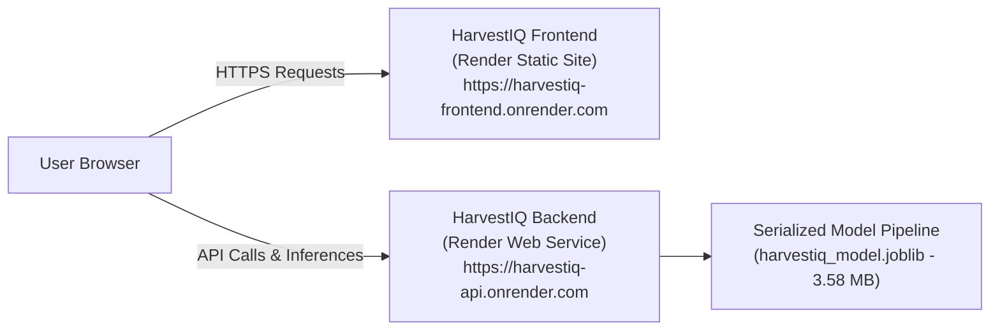

# HarvestIQ – Public Cloud Deployment Guide (GitHub & Render)

This guide provides end-to-end instructions for deploying the **HarvestIQ Crop Recommendation System** to **GitHub** and **Render** (free tier).

---

## Architecture Overview on Render



---

## Prerequisites

Before beginning deployment, ensure you have:
1. A **GitHub account** ([github.com](https://github.com)).
2. A **Render account** ([render.com](https://render.com)) linked to your GitHub account.
3. **Git** installed on your local machine.
4. Python 3.11+ installed locally.

---

## Part 1: GitHub Repository Setup & Push

The HarvestIQ project repository is configured to exclude temporary files, virtual environments, and caches, while explicitly tracking the serialized machine learning model (`backend/models/harvestiq_model.joblib`).

### 1. Verify Model Size & GitHub Limits
The trained model file size is:
- `backend/models/harvestiq_model.joblib`: **3.58 MB**
- GitHub hard limit per file: **100 MB**
- GitHub warning limit: **50 MB**

> [!NOTE]
> Since the model artifact is only ~3.58 MB, **Git Large File Storage (Git LFS) is not required**. The model can be tracked, committed, and cloned directly through standard Git commands.

### 2. Initialize Git and Stage Files
Open your terminal in the project root (`c:\Users\dasar\trustvault` or your cloned directory):

```bash
# Check git status
git status

# Stage all files (the updated .gitignore will automatically exclude venvs and caches)
git add .

# Create a clean, descriptive commit
git commit -m "feat: complete HarvestIQ ML prediction system and Render deployment config"
```

### 3. Create a New Repository on GitHub
1. Log into your account on [GitHub](https://github.com/new).
2. Click **New Repository**.
3. Name your repository (e.g., `harvestiq` or `crop-recommendation-system`).
4. Choose **Public** (recommended for seamless Render integration).
5. **Do not** check "Initialize this repository with a README" (we already have a complete README).
6. Click **Create repository**.

### 4. Push Local Code to GitHub
Copy the remote commands shown on your new GitHub repository page:

```bash
# Set branch to main
git branch -M main

# Link your GitHub repository as remote origin (replace with your actual GitHub URL)
git remote add origin https://github.com/<YOUR-USERNAME>/<YOUR-REPO-NAME>.git

# Push code and tags to GitHub
git push -u origin main
```

---

## Part 2: Render Deployment

You can deploy HarvestIQ on Render using either **Method A (Automated Blueprint - Recommended)** or **Method B (Manual Dashboard Setup)**.

---

### Method A: Automated Deployment via Blueprint (Recommended)

HarvestIQ includes a pre-configured Infrastructure-as-Code specification: `render.yaml`. This blueprint automatically provisions both the FastAPI Web Service and the Static Site in one click.

1. Log into the [Render Dashboard](https://dashboard.render.com).
2. Click **New +** in the top navigation bar.
3. Select **Blueprint**.
4. Connect your GitHub repository:
   - If prompted, grant Render permission to access your repository.
   - Select your `harvestiq` repository from the list.
5. Render will detect `render.yaml` and display the two configured services:
   - **`harvestiq-api`** (Python Web Service)
   - **`harvestiq-frontend`** (Static Site)
6. Click **Apply**.
7. Render will automatically build the backend, install Python dependencies, load the ML model, and deploy the frontend.

---

### Method B: Manual Dashboard Setup

If you prefer configuring services individually through the Render GUI, follow these steps:

#### Step 1: Deploy Backend Web Service (`harvestiq-api`)
1. In the Render Dashboard, click **New +** -> **Web Service**.
2. Select **Build and deploy from a Git repository** -> choose your `harvestiq` repository.
3. Fill in the service configuration:
   - **Name**: `harvestiq-api` (or a unique name like `harvestiq-api-<yourname>`)
   - **Region**: Choose the closest region (e.g., `Oregon (US West)` or `Frankfurt (EU)`)
   - **Branch**: `main`
   - **Root Directory**: `backend`
   - **Runtime**: `Python 3`
   - **Build Command**: `pip install --upgrade pip && pip install -r requirements.txt`
   - **Start Command**: `uvicorn app.main:app --host 0.0.0.0 --port $PORT`
   - **Instance Type**: `Free`
4. Expand **Advanced**:
   - **Health Check Path**: `/health`
   - **Auto-Deploy**: `Yes`
5. Under **Environment Variables**, add:
   - `PYTHON_VERSION` = `3.11.9`
   - `HOST` = `0.0.0.0`
   - `CORS_ORIGINS` = `*`
   - `ENVIRONMENT` = `production`
6. Click **Create Web Service**.
7. Wait 2–3 minutes for the build to finish. Once live, Render will assign your backend a public URL, for example:
   `https://harvestiq-api.onrender.com`

---

#### Step 2: Deploy Frontend Static Site (`harvestiq-frontend`)
1. In the Render Dashboard, click **New +** -> **Static Site**.
2. Choose your `harvestiq` repository.
3. Fill in the configuration:
   - **Name**: `harvestiq-frontend` (or a unique name like `harvestiq-web-<yourname>`)
   - **Branch**: `main`
   - **Root Directory**: `frontend`
   - **Build Command**: *(leave empty)*
   - **Publish Directory**: `.`
4. Click **Create Static Site**.
5. Once live, Render will assign your frontend a public URL, for example:
   `https://harvestiq-frontend.onrender.com`

---

## Part 3: Connecting Frontend to Backend in Production

### Option 1: Quick Connect via UI (Zero Re-deployments)
If your static site is already live, you do not need to re-deploy or change any code to connect it to your backend:
1. Open your deployed static site in your browser: `https://harvestiq-frontend.onrender.com`.
2. Because the frontend initially defaults to `http://127.0.0.1:8000`, the connection banner will appear:
   *Cannot connect to FastAPI at `http://127.0.0.1:8000`*.
3. In the input box provided in the banner, paste your deployed backend URL:
   `https://harvestiq-api.onrender.com`
4. Click **Set URL**.
5. The application will store the URL in your browser's `localStorage` and immediately reconnect to the live model!

### Option 2: Permanent Configuration in Code
To set the default API base URL for all visitors:
1. Open `frontend/config.js`.
2. Update the fallback URL in `resolveApiBaseUrl()` or set the default:
   ```javascript
   // In frontend/config.js
   return "https://harvestiq-api.onrender.com";
   ```
3. Commit and push to GitHub:
   ```bash
   git add frontend/config.js
   git commit -m "chore: point default frontend API URL to Render backend"
   git push origin main
   ```
4. Render will automatically redeploy the static site within seconds.

### Option 3: Lock Down Production CORS
For enhanced production security, restrict backend CORS to your exact frontend domain:
1. Open your `harvestiq-api` Web Service in the Render Dashboard.
2. Go to **Environment**.
3. Edit `CORS_ORIGINS` to:
   ```text
   https://harvestiq-frontend.onrender.com
   ```
4. Click **Save Changes**. Render will automatically restart the service with the restricted CORS policy.

---

## Part 4: Post-Deployment Verification

### 1. Test Backend Health Endpoint
Run this in your terminal or browser:
```bash
curl https://harvestiq-api.onrender.com/health
```
Expected response:
```json
{
  "status": "healthy",
  "service": "HarvestIQ API",
  "version": "1.0.0",
  "model_loaded": true,
  "model_name": "RandomForestClassifier",
  "dataset_present": true,
  "python_version": "3.11.9"
}
```

### 2. Test Live Prediction Inference
Send a sample payload with 7 valid agro-climatic values:
```bash
curl -X POST "https://harvestiq-api.onrender.com/recommend" \
  -H "Content-Type: application/json" \
  -d '{
    "nitrogen": 90,
    "phosphorus": 42,
    "potassium": 43,
    "temperature": 20.8,
    "humidity": 82.0,
    "ph": 6.5,
    "rainfall": 202.9
  }'
```
Expected response (`HTTP 200`):
```json
{
  "success": true,
  "status": "success",
  "recommendation": {
    "primary_crop": "Rice",
    "confidence": 0.9,
    "top_candidates": [
      { "rank": 1, "crop": "Rice", "confidence": 0.9 },
      { "rank": 2, "crop": "Jute", "confidence": 0.1 },
      { "rank": 3, "crop": "Pomegranate", "confidence": 0.0 }
    ],
    "model_name": "RandomForestClassifier",
    "model_version": "1.0.0",
    "score_type": "uncalibrated model score"
  }
}
```

### 3. Verify Live Frontend in Browser
1. Open `https://harvestiq-frontend.onrender.com` in your browser.
2. Confirm the top status pill turns green: **Backend: Online (RandomForestClassifier)**.
3. Click one of the quick preset buttons (e.g., **Rice / High Moisture** or **Chickpea / Legume**).
4. Click **Generate Crop Recommendation**.
5. Verify that the primary crop card, confidence badge, and top-3 ranked alternatives render cleanly.

---

## Part 5: Troubleshooting & Common Pitfalls

| Issue | Cause | Solution |
| :--- | :--- | :--- |
| **Backend "Cold Start" Delay (~50s)** | Render Free Tier spins down web services after 15 minutes of inactivity. | When opening the app after idle time, allow 40–50 seconds for the free instance to spin up. The frontend status pill will show "Connecting...", and the retry button allows refreshing. |
| **Mixed Content Warning (HTTPS to HTTP)** | A frontend hosted on `https://` cannot make requests to an `http://` backend. | Always ensure your backend URL begins with `https://` (e.g., `https://harvestiq-api.onrender.com`). |
| **CORS Blocked Error** | Browser blocks cross-origin fetch because `CORS_ORIGINS` does not include your frontend origin. | Set `CORS_ORIGINS` to `*` or include your exact frontend URL (including `https://` and without trailing slash) in Render Environment variables. |
| **Model Unavailable (HTTP 503)** | `harvestiq_model.joblib` was omitted from the git commit. | Check `git status` locally. Ensure `backend/models/harvestiq_model.joblib` is staged and pushed. Run `git ls-tree -r main backend/models` to confirm it is on GitHub. |
| **Build Fails with Memory Error** | Installing heavy ML libraries can exceed free tier build limits if pip attempts to compile from source. | Ensure `requirements.txt` uses pre-compiled wheels (Python 3.11 with scikit-learn 1.5+ provides standard wheels). |
| **Port Binding Error on Startup** | Uvicorn hardcoded to `8000` instead of reading the `$PORT` environment variable assigned by Render. | Use `uvicorn app.main:app --host 0.0.0.0 --port $PORT` in your Start Command. |
